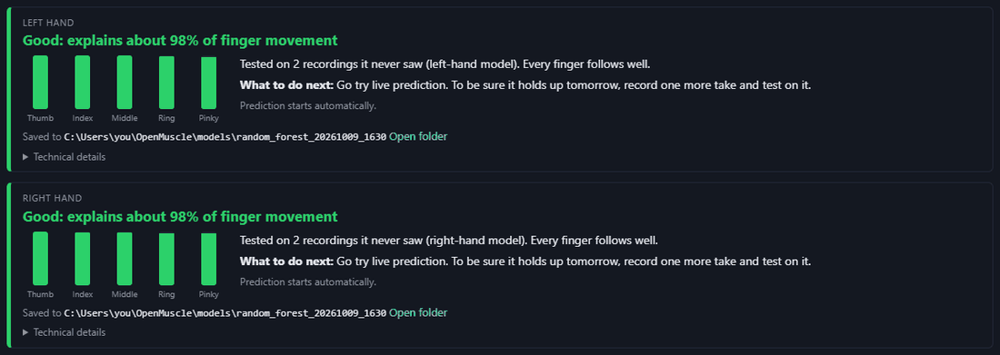
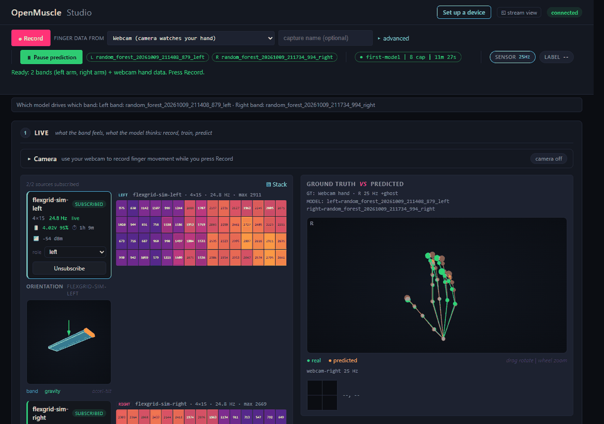

# Your first model in about 15 minutes

This is a script. Follow it once, in order, and you finish with a trained model
that predicts finger movement from the bands, running live in the Studio. Nothing
here needs programming.

You will record eight short takes of named movements, train, read a plain-language
result and try the live prediction. A printable one-page version of the movements
is in [movement-sheet.md](movement-sheet.md).

## Before you start

- Both bands are charged, on your Wi-Fi, and each shows a heatmap in the Studio.
  If not, see [getting-started.md](getting-started.md) and
  [troubleshooting.md](troubleshooting.md).
- You have a computer with a camera (the built-in one is fine) and the Studio is
  open at `http://localhost:8000`.
- Bright, even light, and a place to sit comfortably for 15 minutes with your
  forearms resting on a table or your lap.
- A participant code in mind, such as `P01`. A code is a made-up label. Never use
  a real name anywhere in the Studio. Keep the list that links codes to people
  somewhere else.

No camera? You can still record with **No labeler (bands only; cannot be used to
train)** to watch the bands and keep the files, but a model needs finger data, so
you cannot finish this script without a labeler. See
[webcam-labeling.md](webcam-labeling.md#no-camera-recording-bands-only).

## The plan

| Minutes | What you do |
|---|---|
| 0 to 3 | Start a session, put the bands on, switch the camera on |
| 3 to 5 | Check that everything is live |
| 5 to 12 | Record eight takes of 30 seconds |
| 12 to 14 | Train and read the result |
| 14 to 15 | Watch the live prediction |

These are guides, not limits. The first time through, expect it to take a little
longer.

## 1. Start a session (1 minute)

A session keeps this sitting's takes together and remembers who and which arm.

1. Press **+ session** in the top strip.
2. **Session name**: type `first-model`.
3. **Participant code**: type your code, for example `P01`.
4. **Arm**: choose the arm the band is on. If you wear one band on each arm, choose
   **Both arms**.
5. **Finger data from**: choose **Webcam**.
6. Open **More details**. In **Planned gestures** type
   `rest, open and close, single fingers, grips`. This is only a reminder.
7. Press **Start session**.

The tag in the top strip now shows `first-model`.

> *Mirrored.* If the hand you want a model for cannot be measured (for example
> it is missing, or it is busy), put the band on that limb, point the camera at
> your other hand, and move both sides together. In **More details**, set
> **Mirrored** to **Yes, labels measured on the left hand** or **Yes, labels
> measured on the right hand**, whichever hand the camera watches. Every take in the
> session is then marked as mirrored, and the model is a model for the banded
> limb trained on the other hand's movements. More in
> [webcam-labeling.md](webcam-labeling.md#mirrored-training).

## 2. Bands on, and the same way every time (1 minute)

Put each band on as described in [band-fit.md](band-fit.md): the sensor side against
the skin, snug but not tight, in the same place on the forearm.

Then *do not move the band for the whole script.* A model learns the pressure
pattern of that exact position. If you shift the band halfway through, the
earlier takes teach the model something that is no longer true. If you must
adjust it, start the script again.

## 3. Camera on (1 minute)

1. Open the **Camera** bar and press **Start camera**. If the browser asks, choose
   **Allow**.
2. Hold the hand you will move up to the camera, palm toward it, all fingers
   visible, about an arm's length away. A green skeleton should follow your hand.
3. The line under the top strip should now read like this:

   > Ready: 2 bands (left arm, right arm) + webcam hand data. Press Record.

   If instead it gives a reason, such as telling you to set which arm each band is
   on, fix that first: in each band's card choose **left** or **right** in the
   **role** menu.

Keep that hand in view of the camera for the whole script. Rest the other hand.

## 4. Check everything is live (2 minutes)

Do this once before recording anything.

- *Squeeze test.* Press the band lightly with a finger. The matching spot on the
  heatmap should light up. Do it on each band. If a band stays dark, see
  [troubleshooting.md](troubleshooting.md).
- *Open and close slowly.* The heatmaps should shift and change, and the green
  skeleton should follow your fingers.
- *Update rate.* The **SENSOR** light should show a number in Hz, not **--**. (The
  **LABEL** light is for a LASK5 only and stays at **--** with the camera. Check the
  green skeleton instead.)

## 5. Record eight takes (7 minutes)

Each take is 30 seconds. The same routine, every time:

1. Optional: type a name in **capture name (optional)**, such as `01-open-close`.
2. Press **Record**. The timer starts.
3. Keep your hand *completely still and relaxed for the first 5 seconds.* This
   teaches the model what "no movement" looks like.
4. Do the movement for the take (see the table below) until the timer reaches
   about 0:30.
5. Press **Stop**.
6. Read the card. It says **Saved:** and a word, **Good**, **Check** or **Bad**.
7. Press **Record next take** and go on to the next row.

A take must be at least 10 seconds to count; 30 seconds works best.

### The movements

Do each take slowly and smoothly, as if the movement takes a full breath. Fast,
jerky motion is harder for the camera and for the model.

| Take | Name | Movement | How long |
|---|---|---|---|
| 1 | `01-open-close` | Open the whole hand wide, then close it into a loose fist, and repeat. | 5 s still, then 8 slow cycles of about 3 s each |
| 2 | `02-single-fingers` | Curl one finger at a time down toward the palm and straighten it again, twice each: thumb, index, middle, ring, little finger. Leave the others relaxed. | 5 s still, then about 5 s per finger |
| 3 | `03-grips` | Make a fist, a pinch (thumb tip to index tip) and a point (index straight, others curled), in that order, then repeat the three once. For each: close over 1 s, hold 2 s, open over 1 s, rest 1 s. | 5 s still, then six grips of about 4 s each |
| 4 | `04-free-mix` | Any mix of the movements above, in any order, with short pauses to rest. | 5 s still, then free movement |
| 5 to 8 | `05` to `08` | *Round two.* Repeat takes 1 to 4 in the same order, at your natural pace. A slightly different speed or a slightly different hand position is good. | as above |

Two rounds matter. The Studio keeps your *last one or two takes aside* and tests
the finished model on them, so the score is a fair test on movements the model
never trained on. That is why the final take is the free mix.

*Thumb.* The camera measures all five fingers, including the thumb, so include it.
If you use the optional LASK5 labeler instead of a camera, it measures four
fingers plus a thumb stick; skip the thumb in take 2.

*In a hurry?* Skip takes 4 and 7. You still get two rounds of open and close, two
of single fingers, one of grips and a free mix at the end.

### If a take is marked Check or Bad

The card tells you why in plain words. Typical cases:

- **hand lost** or **labels missing**: your hand left the camera's view. Keep it in
  frame and record that take again.
- **idle labeler**: your hand barely moved. Record it again with fuller movements.
- **weak signal**: the band is not touching your arm. Adjust the band and start
  the script from take 1.
- **too short**: you pressed **Stop** too soon. Aim for 30 seconds.

A **Check** take can still be used. A **Bad** take is better redone. The old take stays
in the list; untick it before you train.

## 6. Train (2 to 3 minutes)

1. Scroll down to **Data & Models**, or press **Go to Train** on the last card.
2. In the **Captures** list, tick your eight takes. The tick box in the column
   header ticks every take shown. While your session is running, the list shows
   only that session's takes, so these are the eight you see. (To see older takes
   too, pick **All sessions** in the session box.)
3. Untick any take marked **Bad**.
4. Press **Train** and wait. It can take from under a minute to a few minutes,
   depending on the computer. The line beside the button says **Training** while
   it works, and when it finishes the result card appears. Do not close the page.

If you recorded with two bands at once, you get two cards, **Left hand** and
**Right hand**: one model for each band.

If the Studio says **Could not train yet**, its message says what to change. The
usual causes are not enough recording, a band that was not touching the arm, or a
finger-data device that did not move.

## Reading the result card

When training finishes, a card appears under the captures list. It has a headline,
one bar per finger, an explanation and a line called **What to do next:**.

### The headline

The headline is one word plus a percentage. The percentage is the model's score on
the take or takes it never trained on, shown as how much of your finger movement
it explains. 100% would be a perfect match. 0% is no better than guessing the
same average position all the time. These are the words and where they start:

| Word | Starts at | In plain terms |
|---|---|---|
| **Good** | 75% | follows your fingers well; try it live |
| **Fair** | 50% | follows the big movements; needs more varied recordings |
| **Weak** | 25% | picks up a little; something about the recording needs fixing |
| **Not working yet** | below 25% | does not predict finger movement yet |
| **Not tested yet** | no score | there was no honest test (see below) |

**Fair** is the best a model can earn from a single take, because the only test
available is the end of that same take. The card says **Held at Fair** when this
happens. Record at least two separate takes for a stronger test, as this script
does.

**Not tested yet** appears when the recording was too short to keep any aside, or
the part kept aside had no finger movement in it. Record a longer take that
includes finger movement, and train again.

### The finger bars

There is one bar per finger: Thumb, Index, Middle, Ring and Pinky (a LASK5 gives
four). A tall green bar means that finger is followed well on the test take;
amber means partly, and red means barely.
The explanation sentence uses the same three levels:

| Wording | Finger score |
|---|---|
| *follows well* | 50% or more |
| *partly tracked* | 25% to 49% |
| *not learned yet* | below 25% |

A finger that did not move at all in the test take shows **did not move in the
test** instead of a bar. It could not be checked, so do not read it as bad.

### What to do next

The card gives one next step. They are:

- **Good**: "Go try live prediction. To be sure it holds up tomorrow, record one more take and test on it."
- **Fair**: "It follows the big movements. Record more takes (including each finger on its own) and train again."
- **Weak**: "Check the band sits snug on the same spot of the arm, record a rest take plus slow single-finger takes, then train again."
- **Not working yet**: "Check the band is snug on the arm and the labeler is moving, then record new takes and train again."

### The status line

Under the explanation the card says whether the model is running:

- **Prediction starts automatically.** The model scored Fair or Good, so it is
  already running.
- **Model saved but not started.** The model was kept but prediction is off. A
  **Start anyway** button appears. Use it only if you want to look; a model that
  scored Weak or lower is usually poor.

Below that, **Saved to** shows the folder (with **Open folder**), and **Technical
details** holds the raw numbers. You do not need them.

## 7. Watch it predict (1 minute)

If the card says **Prediction starts automatically**, the model is already
running. Otherwise press **Predict**.

Look at **Ground truth vs Predicted**. The green hand is what the camera sees and
the amber hand is what the model thinks, using only the bands. Move your fingers
slowly: open and close, then one finger at a time.

*What good looks like.* The amber hand follows the green hand with a short delay.
Open, close and single fingers are all recognisable, and the amber hand relaxes
when you relax.

*What bad looks like.*

- The amber hand barely moves, or shakes while you are still.
- It follows open and close but cannot separate single fingers.
- It was fine, then went wrong after you moved or re-fitted the band.
- It only works for the movements you recorded and does nothing for others.

Most fixes are the same: wear the band the same way, record more varied takes (each
finger on its own, slow and fast, rest between), and train again. A model is for
one person with the bands in one position. If you start a session with a different
participant code or different bands, the Studio shows **This model may not match.**
Train a new model for that person and those bands.

To pause, press **Pause prediction**.

## Next

- Record one more take after taking the bands off and putting them back on. Train
  with it and see how the score changes. That is the honest test of everyday use.
- Press **Export session** to pack the session into one zip file to keep or share.
  See [your-data.md](your-data.md) for where files are saved and how to back them up.
- A tour of every button: [studio-tour.md](studio-tour.md).
- A word you do not know: [glossary.md](glossary.md).
