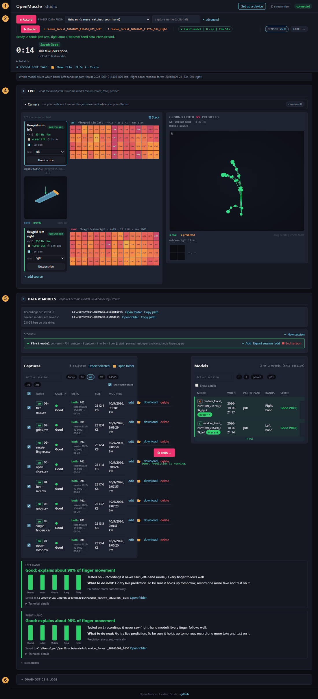
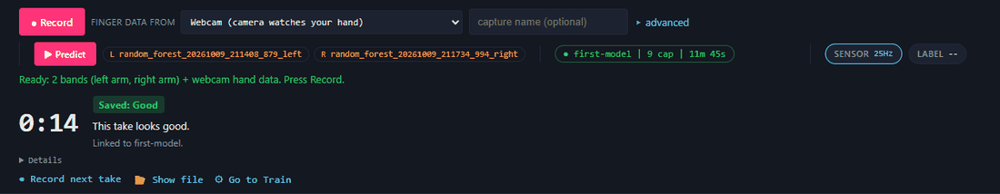

# A tour of the Studio

The Studio is the page `openmuscle web` opens in your browser. Everything you do
with the bands happens here: see the pressure heatmap, record, check a recording,
train a model and watch it predict. This tour goes through the page from top to
bottom, in the order you meet things, using the exact words on the screen.

Words in bold type are labels you can find on the page. If a word here is not on
your screen, your copy of OpenMuscle may be older or newer than this guide; the
page itself always wins. Unfamiliar terms are explained in the
[glossary](glossary.md). To go straight to making your first model, follow
[first-model.md](first-model.md).

The screenshots in this guide were taken from the practice mode
(`openmuscle simulate --device-type rehearsal`), so they show made-up data, not a
person.

The numbers in the picture match the sections below. (Number 3, a notice, appears
only when there is something to say, so it is not marked.)

## Each panel in one line

| Panel | What it is for |
|---|---|
| Top bar | set up a new band, open the stream view, see whether the page is connected |
| Control bar | record, choose the finger-data source, start live prediction, see the session |
| Camera | switch on the computer's camera so it can measure your finger movement |
| Band rows | see each band's state and its live pressure heatmap |
| Ground truth vs Predicted | compare your real finger movement with what the model thinks |
| Where your files are | find the folders holding your recordings and models |
| Session | group the takes of one sitting under a participant code |
| Captures | check, filter and choose the recordings you have made |
| Train and Models | build a model from chosen captures, and keep or load earlier ones |
| Result card | learn in plain words whether a trained model is any good |
| Diagnostics & logs | read what the program has been doing, and set up robot-hand output |

1. [The top bar](#1-the-top-bar)
2. [The control bar](#2-the-control-bar-the-strip-that-stays-at-the-top)
3. [Notices under the control bar](#3-notices-under-the-control-bar)
4. [Stage 1, Live](#4-stage-1-live)
5. [Stage 2, Data and Models](#5-stage-2-data-and-models)
6. [Diagnostics and logs](#6-diagnostics-and-logs)
7. [Pop-up windows](#7-pop-up-windows)
8. [Panels you can ignore at first](#8-panels-you-can-ignore-at-first)

## 1. The top bar

The top bar holds the name, **OpenMuscle Studio**, and four things on the right:

- **Set up a device** opens a step-by-step page that puts a band on your Wi-Fi.
  Use it the first time for each band. More help with Wi-Fi is in
  [wifi-setup.md](wifi-setup.md).
- **Help** opens these guides in a new tab. It works without internet, so you can
  keep it open beside the Studio.
- **stream view** opens a small read-only copy of the heatmaps in a new window.
  It is meant for screen-capture software and changes nothing.
- The round badge says **connected** when the page can talk to the program, and
  **disconnected** when it cannot. If it says **disconnected**, check that the
  `openmuscle web` window is still open, then reload the page.

## 2. The control bar (the strip that stays at the top)

This strip stays on screen as you scroll, so the whole loop of record, train and
predict is always one click away.

**Record** starts a recording and turns into **Stop** while it runs. It only works
when the line under the bar says **Ready**. When it cannot work, that line says
why in plain words (for example, no band found yet, or the camera is not on).

**Finger data from** chooses what measures your finger movement, the "labels" the
model learns from. The choices are:

| Choice | Use it when |
|---|---|
| **Finger labeler (LASK5)** | you have the optional LASK5 labeler |
| **Webcam (camera watches your hand)** | you use the computer's camera (the usual choice for the kit) |
| **VR headset hands (Meta Quest)** | you use a Quest headset |
| **Game controller** | you use a USB game controller as a labeler |
| **No labeler (bands only; cannot be used to train)** | you only want to watch or save band data |

The Studio picks the one that is already sending data, and keeps your own choice
once you make one. Choosing **Webcam** also opens the Camera panel for you. The
camera is the usual choice for the kit; see [webcam-labeling.md](webcam-labeling.md).

**capture name (optional)** is a box for naming the next recording. Leave it empty
and the Studio makes a name. A short clear name such as `03-grips` makes takes
easier to find later.

**advanced** opens three boxes: **Sensor**, **Label dev** and **Window ms**. They
override the automatic choices. Leave them alone unless you were asked to use them.
**Window ms** is how close in time (in milliseconds) a band reading must be to a
finger reading for the two to be paired in the file.

**Predict** starts and pauses live prediction. Before there is a model it reads
**Predict (no model yet, train first)** and cannot be pressed. While a model runs
it reads **Pause prediction**. The small tags beside it name the model in use, or
say **no model, train first**.

The session tag shows **no session (captures ungrouped)** until you start one.
**+ session** opens the form that starts a session (see [section 7](#7-pop-up-windows)).
Once a session is running, the tag shows its name, how many captures it has and
how long it has been running.

**SENSOR** and **LABEL** are two small lights that show how fast data is arriving,
in Hz. **SENSOR** follows the band whose card is selected (click a card to change
it) and turns orange if nothing has arrived for two seconds. **LABEL** follows a
LASK5 labeler only, so it stays at **--** when you use the camera; the **Camera**
bar shows the camera's own status instead. **--** means nothing is arriving.

Under the strip, the **Ready** line (or the reason you cannot record) is always
present. For example:

> Ready: 2 bands (left arm, right arm) + webcam hand data. Press Record.

While you record, the same area shows a big timer and one plain sentence for
anything wrong. A **Details** fold-out holds the counters. When you press **Stop**,
it becomes a card that reads **Saved:** followed by a quality word
([Good, Check or Bad](#quality-words-for-a-take)), and three buttons:

- **Record next take** gets the name box ready for the next recording.
- **Show file** shows the new file in your file manager.
- **Go to Train** ticks the new take for you and scrolls to the training area.

### Quality words for a take

Every take gets a quality word, shown in the **Quality** column of the captures list
and on the card after you stop:

| Word | Meaning |
|---|---|
| **Good** | no problems found |
| **Check** | usable, but something is worth a look (for example some finger data went missing) |
| **Bad** | something is wrong enough that the take may teach nothing (for example the band was not touching your arm) |

Small tags beside the word say what was found: **empty**, **too short**,
**weak signal**, **no labels**, **labels missing**, **idle labeler** and
**hand lost**. Hover over a word to read the full sentence.

A take shorter than 10 seconds is tagged **too short** and is left out when
**Go to Train** ticks takes for you. It is never deleted. Aim for 30 seconds or more.

## 3. Notices under the control bar

A banner appears here only when there is something to say:

- A model saved from your last visit is waiting for you to press **Predict**.
- **This model may not match.** The loaded model was trained for a different
  participant code or different band units than the ones in front of you.
  Predictions from a mismatched model are usually poor. Train a new model for
  this participant and these bands, or press **Predict** to run it anyway.
- **Which model drives which band** lists, for a two-band kit, the model used by
  each side.

## 4. Stage 1, Live

The first big section is titled **Live**: "what the band feels, what the model
thinks".

### The Camera panel

The **Camera** bar sits at the top of this section. Press it to open the panel,
then press **Start camera**. The first time,
the browser asks for permission to use the camera; choose **Allow**. A picture of
your hand appears with a green skeleton drawn on it, and five finger bars show
the curl numbers being recorded. Beside the bar, a short status says **camera off**,
**camera on** with what it sees, or **camera problem**. The panel keeps working
when you close it. Everything about it is in [webcam-labeling.md](webcam-labeling.md).

### The band rows (left side)

Each band that is sending data gets one row: a small card on the left and its
heatmap on the right.

The **card** shows:

- the band's id, with a badge that says **streaming**, **subscribed**, **known**
  or **error**;
- the size of the grid as the band reports it (for example `4×15`, which describes the 60 sensing cells; a real band may print the two numbers the other way round),
  how fast data arrives in Hz, and **live** when data is fresh or the number of
  seconds since the last data when it is not;
- the battery, how long the band has been on, and the Wi-Fi signal strength in dBm
  (closer to 0 is stronger, below about -80 is weak);
- a **role** menu with **untagged**, **left**, **right** and **labeler**;
- a **Subscribe** or **Unsubscribe** button.

Set **role** to **left** or **right** to say which arm each band is on. With two
bands, each must have a different arm before **Record** will work.

The **heatmap** is a picture of the 60 cells. Dark grey means no pressure; the
colour moves through blue, purple, pink and orange to yellow as pressure rises.
Press on the band with a finger and the matching cell lights up. If the whole picture stays dark
when you squeeze the band, see [troubleshooting.md](troubleshooting.md).

Other things in this area:

- **Stack** (with **Side by side** when stacked) switches two bands between sitting
  next to each other and one above the other.
- A count such as 2/2 sources subscribed says how many discovered devices are
  being listened to. The Studio subscribes to bands automatically.
- Devices that were found but are not sending yet appear as small cards with a
  **Subscribe** button.
- **Add a device by IP address** opens a box to add a band by its address, plus a **Scan subnet**
  button that searches your network for bands. You normally do not need either;
  they are for the case where a band is on but does not appear
  ([troubleshooting.md](troubleshooting.md)).
- **Orientation** shows a small 3D picture of how the band is tilted, drawn from
  its motion sensor. It is informational.
- When nothing has been found, the area reads **No band found yet.** with a
  **Set up a device** link.

### Ground truth vs Predicted (right side)

This area compares what the labeler says your fingers are doing (ground truth)
with what the model thinks from the band alone (predicted).

- With the webcam or a headset, you see a 3D hand. **real** is drawn in green and
  **predicted** in amber. You can drag to rotate it and use the mouse wheel to
  zoom. (The 3D hand needs the viewer files: connect to the internet once, or run
  `openmuscle assets fetch`.)
- With a LASK5, you see bars named P1 to P4: for each finger, the upper bar is the
  real value and the lower bar is the prediction, with the difference underneath.
- **GT:** names the device currently measuring your fingers. **MODEL:** names the
  model currently running, or says **no model loaded**.

Until a model is running, only the ground-truth side moves.

## 5. Stage 2, Data and Models

The second big section is **Data & Models**: "captures become models".

### Where your files are

At the top, two lines say where recordings and trained models are saved. Each has
**Open folder** (shows the folder in your file manager, available on the computer
running OpenMuscle) and **Copy path**. A warning appears when the drive is nearly
full. More in [your-data.md](your-data.md).

### Session

A session groups the takes of one sitting and remembers who and which arm. The
card shows **No active session** until you press **+ New session**. With a session
running, its card shows the name, arm, participant code, number of captures, how
long it has run, and these buttons:

- **+ Add** attaches earlier captures to this session.
- **Export session** packs the session into one zip file to give to someone.
- **edit** changes the session details.
- **End session** closes the session.

Past sessions stay under **Past sessions**, a fold-out near the bottom of this
section.

### Captures

**Captures** is the list of everything you have recorded. At the top:

- a count such as **0 selected**, and **Export selected** and **Open folder**;
- filters: a session box, **today** / **7d** / **all**, label chips **VR** and
  **LASK5**, hand chips **1H** and **2H**, and **show short takes** (untick it to
  hide takes under 10 seconds).

While a session is running, the session box says **Active session** and the list
shows only that session's takes. Type or pick **All sessions** in it to see every
take you have ever recorded. The **Models** list has the same box.

Each row has a tick box, the name, the **Quality** word, a short summary of its
details, size and time, and four actions: **edit** (add a participant code, a
note), the folder icon (show the file), **download** and **delete**. A row marked
**1H** has one band, **2H** has two.

Tick the takes you want to learn from. The tick box in the header ticks all
visible takes.

### Train

The **Train** button sits between the two lists and is only available when at least
one capture is ticked. While it works, the line beside it says it is training,
which takes a few minutes for each band (roughly 4 to 5 minutes on an ordinary
laptop), depending on the computer. With two bands they are trained one after the
other and the line shows "1/2" and then "2/2". When it finishes, the result card
appears underneath ([how to read it](first-model.md#reading-the-result-card)).

### Models

**Models** lists every trained model with columns **Model**, **When**,
**Participant**, **Bands** and **Score**. The score shows a word,
**Good** (with a percentage after it, such as 82%), **Fair**, **Weak**,
**Not working yet** or **Not tested yet**.
Filters let you narrow by session and by **L** (left band), **R** (right band) or
**pooled** (not tied to one band). **Show details** adds technical columns that you
can ignore. A model that is running has an **in use** tag; others have a **Load**
button, which loads the model without starting prediction.

### The result card

After training, a card shows a headline, one bar per finger, a short explanation
and **What to do next:**. It ends with where the model was saved (with
**Open folder**) and a fold-out called **Technical details**. This card is the one
place to look to judge a model. The words and what to do about each are in
[first-model.md](first-model.md#reading-the-result-card).

## 6. Diagnostics and logs

At the very bottom, **Diagnostics & logs** opens a log of what the program has been
doing. It has a level menu (**all levels**, **warn + error**, **errors only**),
**clear view**, and **auto-scroll**. If you ask for help, the last lines of this log
are useful. It also holds **Output routing**, covered below.

## 7. Pop-up windows

**Start new session** (from **+ session** or **+ New session**) asks for:

- **Session name** (optional), such as `morning-baseline`;
- **Participant code**: a short code such as `P01`. Never type a name. If the
  box looks like a name, the Studio warns you softly, though it still saves;
- **Arm**: **Not set**, **Left arm**, **Right arm** or **Both arms**;
- **Finger data from**: **Decide when I record**, **Webcam**, **LASK5 finger
  labeler (optional hardware)**, **VR headset hand tracking**, **VR headset and
  LASK5** or **Gamepad**;
- under **More details**: **Take number**, **Mirrored**, **Planned gestures**,
  **Video note**, **Tags** and **Notes**.

**Mirrored** is for the case where the hand you want a model for cannot be
measured, so a labeler watches the other hand while you move both together. See
[the mirrored section in webcam-labeling.md](webcam-labeling.md#mirrored-training).

**Edit capture metadata** (from **edit** on a row) lets you set the arm, the
**Participant code**, a **Gesture / motion** and **Tags** and **Notes** for one take.

**Export** (from **Export session** or **Export selected**) shows the estimated
size and two options: **Include full raw streams** (large, usually not needed) and
**Include my notes**. **Download zip** saves a single zip with a plain-language
README inside. Trained models are never included.

## 8. Panels you can ignore at first

- **Debug**: only appears when the program was started with `--debug`. It shows
  raw numbers for troubleshooting and is not needed for normal use.
- **Output routing** (inside **Diagnostics & logs**): a box for sending predictions
  to a robot hand on your network. Leave it empty unless you have one.
- **advanced** in the control bar: see above.
- **Show details** in the models list: technical columns.

## What to read next

- [first-model.md](first-model.md): a plan for your first model, about 15 minutes of recording plus training time.
- [troubleshooting.md](troubleshooting.md): what to do when something does not
  appear or does not work.
- [glossary.md](glossary.md): the words used in this guide.
